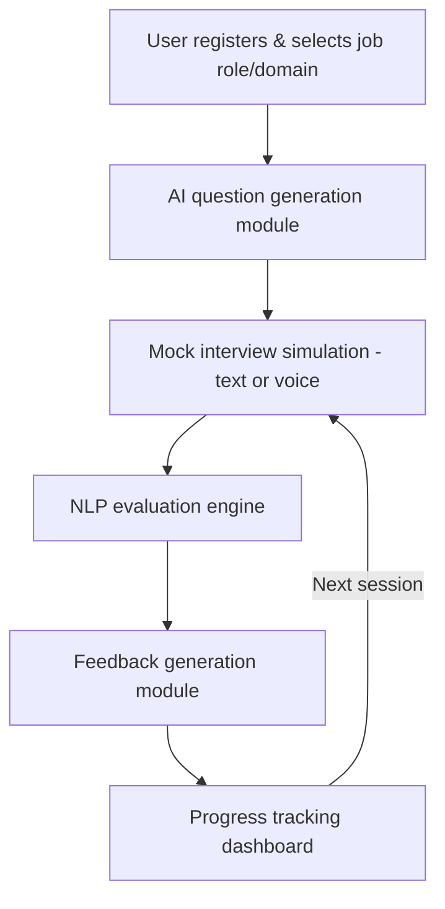

# AI Interview Preparation System — Product Requirements Document

**Date:** September 25, 2026
**Author:** Jatin Soni
**Project ID:** CSE_M2_22
**Guide:** Ms. Ekta Vyas
**Team:** Jatin Soni, Preet Bhatiya, Bhavi Soni (B.Tech CSE, Silver Oak University)

## 1. Overview

A web application that helps students and job seekers practice and improve interview skills using AI. It generates personalized Technical and HR interview questions based on a selected job role and domain, simulates a realistic mock-interview environment, and evaluates responses to give instant feedback on communication, confidence, and technical accuracy. Progress tracking, performance reports, and learning recommendations round out the platform.

**Goal:** reduce interview anxiety and improve success in placements, internships, and job interviews.

## 2. Problem Statement & Background

Most students and fresh graduates struggle with interview anxiety because they lack structured, realistic practice opportunities. Traditional preparation methods (question banks, books, generic mock sessions) don't offer personalized or instant feedback.

Existing recruitment-tech research increasingly applies AI/NLP (text classification, semantic similarity, sentiment/tone analysis) to automate screening and evaluate interview answers. Most existing tools focus on either technical question banks *or* generic chatbot interviews — few combine role-specific question generation with detailed, multi-factor feedback in one accessible platform. That gap is what this project addresses.

## 3. Goals & Objectives

- Design and develop an AI-based web platform for practicing Technical and HR interviews
- Generate personalized interview questions based on the selected job role and technical domain
- Evaluate user responses using NLP for communication skills, confidence, and technical accuracy
- Provide instant, meaningful feedback with identified strengths and areas for improvement
- Track user progress across multiple sessions via performance reports and learning recommendations
- Build a simple, user-friendly application accessible from any device with internet access

## 4. Target Users

- Engineering students preparing for campus placements
- Fresh graduates entering the job market
- Working professionals preparing for job changes or internal interviews
- College placement/training cells wanting a scalable practice tool for their students

## 5. Scope

### In scope
- Role- and domain-based question generation for Technical and HR interviews
- Text- and voice-based mock interview simulation
- NLP-based evaluation of communication, confidence, and technical accuracy
- Instant feedback, strengths/weaknesses identification, and improvement suggestions
- Progress tracking dashboard and performance reports across sessions

### Out of scope (initial release)
- Live human-interviewer video calls or human proctoring
- Multi-language interview support (English only at launch)
- Integration with company-specific applicant tracking systems (ATS)
- Native mobile apps (web application only at launch)

## 6. Key Features / Functional Requirements

| Feature | Description |
| --- | --- |
| User registration & role selection | User signs up and selects a target job role and technical domain |
| Question generation | AI-based module creates relevant Technical and HR questions for the chosen role/domain |
| Mock interview simulation | Realistic simulated interview where the user responds via text or voice |
| Response evaluation | NLP-based engine analyzes each response for communication, confidence, and technical accuracy |
| Feedback generation | Instant feedback highlighting strengths, weaknesses, and improvement suggestions |
| Progress tracking | Dashboard storing performance reports and learning recommendations across sessions |

## 7. User Flow

1. User registers and selects a target job role and technical domain.
2. The AI-based question generation module creates relevant Technical and HR questions.
3. The user responds via text or voice in a realistic mock-interview simulation.
4. The NLP-based evaluation engine analyzes each response for communication, confidence, and technical accuracy.
5. The feedback generation module highlights strengths, weaknesses, and improvement suggestions.
6. The progress tracking dashboard stores performance reports across sessions to guide continuous improvement.

## 8. Technical Requirements & Architecture

| Layer | Technology |
| --- | --- |
| Frontend | HTML, CSS, JavaScript / React.js |
| Backend | Python (Flask / Django) or Node.js |
| AI / NLP | NLTK, spaCy, and LLM APIs for question generation and answer evaluation |
| Database | MongoDB |
| Speech Processing | Speech-to-Text APIs for verbal response analysis |
| Version control & deployment | Git, GitHub, and a cloud hosting platform |

## 9. Non-Functional Requirements

- **Usability:** simple, intuitive interface usable by non-technical students with minimal onboarding
- **Accessibility:** accessible from any device with an internet connection (responsive web design)
- **Performance:** near-instant feedback after each interview response
- **Reliability:** consistent question generation and evaluation across sessions
- **Data privacy:** secure storage of user responses, recordings, and performance history
- **Scalability:** able to support concurrent mock-interview sessions as the user base grows

## 10. Success Metrics

- Number of mock interview sessions completed per user
- User-reported reduction in interview anxiety / increase in confidence (survey-based)
- Accuracy and relevance of AI-generated feedback (validated against human evaluators)
- User retention across multiple sessions (progress-tracking engagement)
- Placement/interview success rate reported by users after using the platform

## 11. Risks & Open Questions

- Which LLM API and speech-to-text provider to use, and at what cost, for production
- Accuracy of NLP-based confidence/tone scoring compared to human evaluators
- Data privacy and retention policy for recorded/voice responses
- Handling accents and speech-to-text errors during voice-based mock interviews
- Additional peer-reviewed literature to be added as the survey progresses

## 12. References

1. NLTK Documentation
2. spaCy Documentation
3. OpenAI API Documentation
4. React.js Documentation
5. Additional peer-reviewed references on AI-based mock interview and NLP-driven feedback systems, to be added as the literature survey progresses
